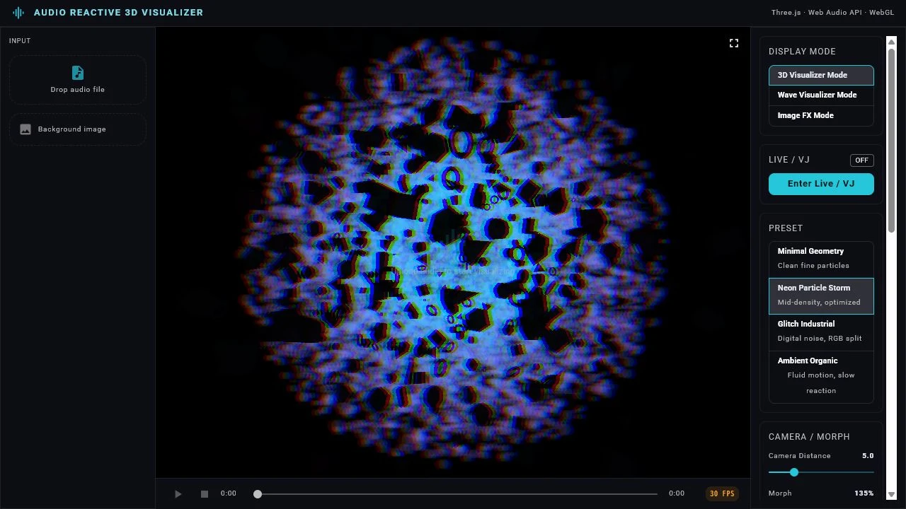

# phase-viz

phase-viz is a browser-native audio visual engine for creating, performing, and exporting reactive music visuals.

[Live demo](https://waveform.tranjectories.xyz/) - [Contributing](CONTRIBUTING.md) - [MIT License](LICENSE)



phase-viz currently ships as a full creative web app, but the project is being shaped as a reusable engine for musicians, VJs, creative coders, and developers building browser-native audiovisual tools.

## Why phase-viz?

- Browser-native audio analysis
- Real-time VJ mode
- MP4 export with WebCodecs and ffmpeg.wasm fallback
- JSON-shareable preset foundation
- Modular visual-mode architecture
- Built for musicians, VJs, and creative coders

## What It Does Today

- Imports local audio files and analyzes them with the Web Audio API
- Renders three visual modes: 3D Visualizer, Wave Visualizer, and Image FX
- Supports configurable particles, waveform styles, image effects, visual layers, and presets
- Provides Live / VJ mode with fullscreen, hidden UI, shortcuts, intensity, and boost controls
- Exports MP4 locally in the browser with Fast 720p and High 1080p presets
- Exports 9:16 Shorts / Reels clips of the track's hook with an optional title and credit
- Keeps selected media local to the browser; no app backend upload is required

## Engine Direction

The current app is the reference implementation for a broader engine architecture:

```txt
src/
  app/          React shell, layout, panels, and stage composition
  engine/       AudioFrame, VisualMode, PresetRegistry, and ExportEngine foundations
  modes/        Visual mode packages and contributor examples
  state/        Zustand slices grouped by responsibility
  ui/           Existing feature UI and rendering surfaces
  audio/        Web Audio analysis utilities
  visual/       Existing Three.js scene, presets, particles, and image FX
  export/       Existing browser MP4 encoder implementations
```

The refactor is intentionally incremental. Existing visual output and app behavior remain the compatibility layer while new engine-facing APIs are introduced around them.

See [docs/ARCHITECTURE.md](docs/ARCHITECTURE.md) for the current map.

## Quick Start

Prerequisites: a current Node.js LTS release and npm.

```bash
git clone https://github.com/7g3n/phase-viz.git
cd phase-viz
npm ci
npm run dev
```

Open the local URL printed by Vite, then drop in a supported audio file (`wav`, `mp3`, `flac`, `ogg`, or `aac`). A background image can be added as JPEG, PNG, WebP, or GIF.

Create a production build with:

```bash
npm run build
```

Run linting with:

```bash
npm run lint
```

## Adding a Visual Mode

New modes should move toward the `VisualModeDefinition` contract:

```ts
export type VisualModeDefinition<TConfig = unknown> = {
  id: string;
  name: string;
  description?: string;
  defaultConfig: TConfig;
  render: (context: RenderContext<TConfig>) => React.ReactNode;
};
```

There is a small example at [src/modes/exampleMinimal](src/modes/exampleMinimal/README.md). It demonstrates the intended folder shape without changing the production mode switch yet.

## Presets

The engine preset foundation lives in `src/engine/preset/`.

```ts
export type PhaseVizPreset = {
  schemaVersion: number;
  id: string;
  name: string;
  author?: string;
  description?: string;
  mode: string;
  visual: Record<string, unknown>;
  audioMapping?: Record<string, unknown>;
  effects?: Record<string, unknown>;
  export?: Record<string, unknown>;
};
```

Built-in visual presets are mirrored into JSON-friendly preset records so future work can add import, export, sharing, migration, and user preset collections without rewriting the current UI.

## MP4 Export

The UI now calls an `ExportEngine` wrapper while existing encoders remain in place:

1. Visual modes provide an `ExportFrameRenderer`.
2. `ExportEngine` applies the selected export preset and progress/status callbacks.
3. The current renderer uses WebCodecs when compatible.
4. If fast export is unavailable or fails, the renderer retries with ffmpeg.wasm.
5. The completed MP4 is generated as a browser blob and downloaded locally.

Long tracks and complex scenes can require substantial memory and processing time. Keep the tab open while an export is running.

### Shorts / Clip Export

Turn on **Shorts / Clip** in the export panel to render part of a track as a vertical clip:

- 15, 30, or 60 second clips. The start point follows automatic hook detection (`src/audio/hook.ts`) until you drag it: windows are scored by spectral energy, transient density, and how much louder they are than the preceding seconds, and candidates start on transient onsets.
- 720 x 1280 and 1080 x 1920 presets. The stage previews the 9:16 frame, and the 3D camera pulls back in portrait so the scene is not cropped.
- Optional title, artist, and credit text burned into every frame (`src/export/overlay.ts`), previewed live on the stage.
- Audio is sliced with a short fade-in and an equal-power fade-out (`src/export/clip.ts`). Full-track exports without the clip option are unchanged.

## Privacy

Selected audio files and background images are read and processed in the browser. The application does not upload selected media to an application backend, and MP4 rendering also happens locally.

Normal web requests are still made to load the application. When local ffmpeg core assets are unavailable, the fallback exporter downloads those runtime assets from jsDelivr.

## Browser Compatibility

A current desktop Chromium-based browser is recommended for the fastest WebCodecs export path. The app checks encoder support at runtime and can fall back to ffmpeg.wasm in browsers that support the required WebAssembly features.

Exact codec, fullscreen, performance, and file-decoding support varies by browser and device. There is not yet a maintained compatibility matrix, and the fixed desktop workspace is not optimized for small screens.

## Tech Stack

- React 19 and TypeScript
- Vite
- Three.js, React Three Fiber, and React Three Drei
- WebGL and Canvas 2D
- Web Audio API
- Material UI and Emotion
- Zustand
- WebCodecs, mp4-muxer, and ffmpeg.wasm
- Cloudflare Workers Static Assets

## Technical Write-up

- [How I Built an Audio-Reactive 3D Visualizer with Three.js and the Web Audio API](https://dev.to/7g3n/how-i-built-an-audio-reactive-3d-visualizer-with-threejs-and-the-web-audio-api-6an)

## Related Projects

- [Web Audio Three.js Starter](https://github.com/7g3n/web-audio-threejs-starter): a minimal React and TypeScript starter for mapping local audio analysis to a Three.js mesh and particle system.

## Contributing

Contributions are welcome. Start with [CONTRIBUTING.md](CONTRIBUTING.md), review the [Code of Conduct](CODE_OF_CONDUCT.md), and use issues or pull requests for bugs, ideas, and improvements.

Good first architecture contributions include:

- A new visual mode under `src/modes/`
- A preset migration or validation improvement
- Documentation for audio mappings or browser compatibility
- Tests around state slices, preset schema, or export utility behavior

Please open an issue before beginning a large behavioral or architectural change. Security reports should follow [SECURITY.md](SECURITY.md).

## Roadmap

- Move production visual modes fully onto `VisualModeDefinition`
- Add preset import/export UI for JSON presets
- Add automated tests for audio analysis, state transitions, and export utilities
- Improve keyboard and screen-reader accessibility throughout the workspace
- Add responsive layouts for narrower screens
- Publish a tested browser compatibility matrix

## License

Licensed under the [MIT License](LICENSE).

## Author

Created by **Nagisa Dozono (TRAJECTORIES)**.

- [GitHub: @7g3n](https://github.com/7g3n)
- [X: @nagisa7g](https://x.com/nagisa7g)
- [Live demo](https://waveform.tranjectories.xyz/)
- [Music video created with the visualizer](https://www.youtube.com/watch?v=R8ItWr2V_ZA)
